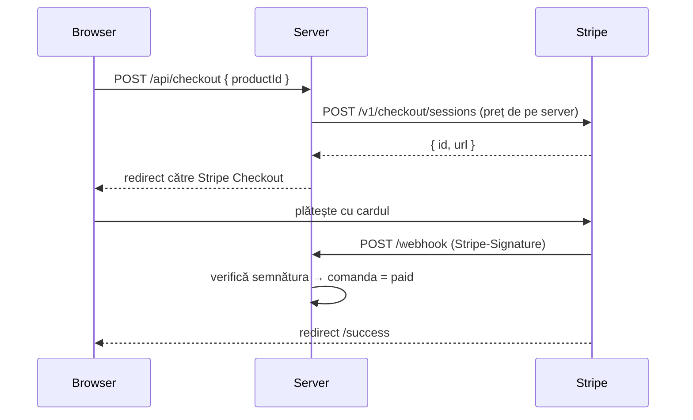

<h1 align="center">💳 stripe-checkout-starter</h1>

<p align="center">Plăți cu cardul prin <b>Stripe Checkout</b> — plăți unice și abonamente, cu webhook-uri verificate prin semnătură.<br>Node.js pur, fără SDK și fără dependențe.</p>

<p align="center">


</p>

---

## De ce există

Am integrat plăți Stripe în magazine online, platforme SaaS și abonamente PRO. Greșelile care apar cel mai des sunt aceleași de fiecare dată:

| Greșeală frecventă | Cum e rezolvată aici |
|---|---|
| Prețul vine din browser și poate fi modificat | Clientul trimite doar `productId`; **suma e citită de pe server** |
| Comanda e marcată „plătită” pe pagina de succes | Statusul se schimbă **doar din webhook**, după verificarea semnăturii |
| Webhook-uri acceptate fără verificare | HMAC-SHA256 pe corpul brut + comparare în timp constant + **toleranță de 5 minute** (anti-replay) |
| Dublu-click creează două sesiuni | `Idempotency-Key` la fiecare cerere POST către Stripe |
| Cheie live pe HTTP | Serverul **refuză să pornească** |

## Flux



## Pornire rapidă

```bash
git clone https://github.com/Gabrieldevro/stripe-checkout-starter.git
cd stripe-checkout-starter
cp .env.example .env        # pune cheile de TEST din dashboard.stripe.com
npm start                   # http://localhost:4242
```

Pentru webhook-uri în local, folosește [Stripe CLI](https://docs.stripe.com/stripe-cli):

```bash
stripe listen --forward-to localhost:4242/webhook   # afișează whsec_... pentru .env
```

Card de test: `4242 4242 4242 4242`, orice dată din viitor, orice CVC.

## Structură

```text
src/stripe.js   client REST Stripe (fetch) + verificare semnătură webhook
src/app.js      server HTTP: catalog, checkout, webhook, pagina de succes
public/         pagina cu produse
test/           teste pentru semnături și pentru fluxul complet, rulate offline
```

## Evenimente tratate

- `checkout.session.completed` și `checkout.session.async_payment_succeeded`: comanda devine plătită
- `checkout.session.async_payment_failed`: comanda e marcată eșuată
- `customer.subscription.deleted`: abonamentul e anulat

## Teste

```bash
npm test
```

Testele simulează Stripe complet. Verifică semnăturile false, pe cele expirate, prețurile trimise din browser și fluxul complet checkout → webhook → comandă plătită.

---

<p align="center">Făcut de <a href="https://gabrieldev.eu"><b>Gabriel Dev</b></a>. Am integrat Stripe în magazine online și platforme SaaS cu abonament.<br>
Vrei plăți online pe site-ul tău? <a href="https://gabrieldev.eu/contact">Scrie-mi</a>.</p>
